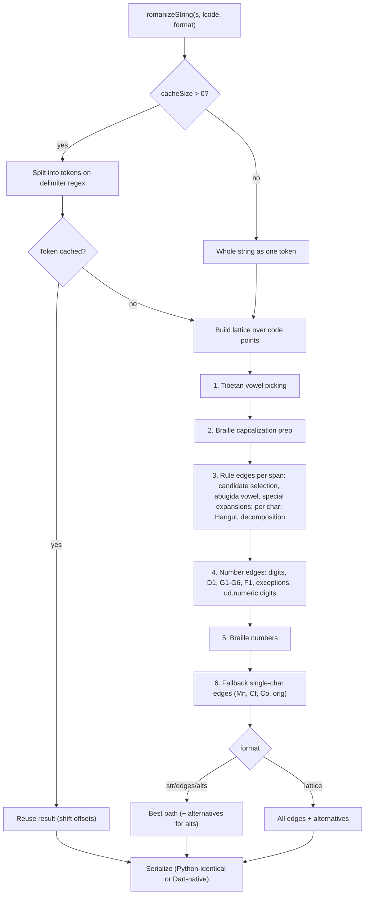
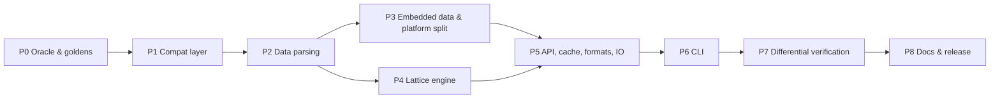

# Dart Implementation Plan for `uroman`

## Goal
Build a pure Dart reimplementation of [uroman](https://github.com/isi-nlp/uroman) (Universal Romanizer, Python v1.3.1.1) whose **external output matches Python uroman by default**, while embracing Dart's type system, performance, and cross-platform flexibility.

- **Pure Dart**: Zero external dependencies for the core library. Does not depend on or import Flutter, but provides a Flutter-friendly API.
- Supports every language and script that uroman supports.
- Supports all 4 output formats: `str`, `edges`, `alts`, `lattice`.
- Runs on the Dart VM, AOT, Dart Web, servers, and seamlessly in Flutter apps (mobile, desktop, web).
- Initializes with zero IO from embedded data. `Uroman.fromDataDir(...)` loads custom data (non-web only).
- Includes a CLI (`bin/uroman.dart`) matching Python's user-facing flags (only `args` dependency).
- The published package has **no Python dependency**. Python is used only during development to generate reference ("golden") data and Unicode tables.

---

## Decisions

| Topic | Decision |
|---|---|
| Package type | **Pure Dart package**. No Flutter SDK dependency or Flutter imports. Zero dependencies for the core library. |
| Parity target | Byte-identical **output** by default (`str` text, `edges`/`alts`/`lattice` JSON lines, CLI stdout). The internal design is free to differ. |
| Embracing Dart | Provide superior Dart-native APIs: strongly typed models, native UTF-16 offsets for Dart `String.substring` / Flutter text widgets, standard RFC-8259 JSON, crash resilience, and streaming/isolate options. |
| Oracle | Python **3.13** (Unicode 15.1, matching `UnicodeData-v15.1.0.txt` in upstream repo), managed with `uv`, with upstream uroman pinned to a commit SHA. Dev-only. |
| Platforms | Dart VM, AOT, Dart Web, server, Flutter. The core library never imports `dart:io`. |
| Embedded data | Embed raw data-file text (comments stripped) as Dart string constants. Parse lazily with the **same parser** that `fromDataDir` uses. Single code path avoids drift. |
| Ambiguous edge picks | Where Python's choice is arbitrary (set order, §Risks 4), use a deterministic "first inserted wins" rule. Measure how often it happens and document any differences. |
| CLI | Match all user-facing flags that are cheap to match. Omit developer flags that only print Python internals. |

---

## Embracing Dart & "Better Than Python" Strategy

### 1. Code Points vs. UTF-16 (Pure `dart:core`, No Extra Dependencies)
- **Internal Engine uses Code Points (`runes` / `List<int>`)**:
  - Romanization rules in uroman operate on **sub-grapheme elements**: viramas (्), vowel modifiers (े, ิ), Hebrew vowel points (nikkud), Thai tone marks, and Japanese small kana.
  - For example, the Hindi syllable **क्षे** is 1 grapheme cluster, but 4 code points (`क`, `्`, `ष`, `े`). Grouping by grapheme clusters at the engine level would break abugida vowel injection, virama deletion, and contextual rules.
  - Therefore, the internal lattice operates strictly on Unicode code points (`List<int>`), completely immune to Dart UTF-16 surrogate splitting.
- **Dart-Native & Flutter-Friendly `Edge` API without `package:characters`**:
  - Python uroman only returns code-point offsets `[start, end]`. In Dart and Flutter, `String.substring()`, `TextSpan`, and `TextSelection` index by **UTF-16 code units**.
  - In Dart uroman, each `Edge` will provide:
    - `start` & `end`: Code point offsets (100% identical to Python uroman).
    - `utf16Start` & `utf16End`: Native Dart UTF-16 code-unit offsets, computed purely using `dart:core`.
  - This allows any Dart or Flutter app to slice original strings or highlight text directly with `text.substring(edge.utf16Start, edge.utf16End)` without any index conversion loops or external dependencies.

### 2. Category A: Architectural & Developer Experience Enhancements (Zero Output Drift)
- **Strongly Typed Models**: Sealed classes / enums for `RomFormat`, concrete `Edge` objects, typed result classes instead of dynamic `str | List[Edge]` unions.
- **Dual JSON Serialization**:
  - `edge.toPythonJson()` / CLI mode: reproduces Python's quirk (no commas between edge lists, e.g. `[[0, 1, "a", "rom"][1, 2, "b", "rom"]]`) for golden testing and CLI compatibility.
  - `edge.toJson()` / standard `jsonEncode`: outputs standard, valid RFC-8259 JSON array of objects or lists for modern Dart/Flutter backends and frontends.
- **Asynchronous & Streaming APIs**:
  - `Stream<String> romanizeLines(Stream<String> lines)` for processing huge text files without loading entire corpora into memory.
  - Isolate support for off-main-thread romanization.

### 3. Category B: Crash Resilience & Error Handling
- Upstream Python crashes on certain edge cases (for example, in `add_numbers` G5, dereferencing a `None` edge causes `AttributeError: 'NoneType' object has no attribute 'value'`).
- Dart implementation uses sound null safety to gracefully handle and skip invalid edges rather than throwing an unhandled exception.

### 4. Category C: Upstream Quirks & Bug Policy
- Maintain a dedicated document `docs/upstream_quirks.md`.
- Several apparent bugs exist in upstream Python that affect output:
  | Line in `uroman.py` | Issue in Python code | Impact |
  |---|---|---|
  | 1436 | `chr_script_name(prev_char) == chr_script_name(prev_char)` | Always `True` (comparing variable with itself). |
  | 1720 | `not regex.search('r[aeiou]', rom)` | Typo for raw regex `r'[aeiou]'`; searches for literal letter `'r'` followed by a vowel. |
  | 1613 | `if n_letters == 2: cost = 0 if i == 0 else 0.1` | Likely intended `rel_pos == 0` instead of `i == 0`. |
  | 1519 | `if rom.endswith(' ') and ((end == len(full_string)+1) ...)` | `end == len(full_string)+1` can never be true as `end <= len(full_string)`. |
- **Policy**: Match Python output by default so existing ML datasets (e.g., Meta's MMS speech datasets) remain 100% compatible. Document each quirk in `docs/upstream_quirks.md`. In the future, we can provide an optional `strict: false` or `fixQuirks: true` flag if desired.

---

## Fidelity Contract

"Identical output" means:
1. `romanizeString(s, lcode, format)` returns exactly what Python returns by default, for every format and for both cache modes (cache off = the Python API default, cache on = the CLI default).
2. `edges`/`alts`/`lattice` serialize to the same bytes as Python's `Edge.json_str`. That includes `ensure_ascii` escaping, `", "` separators, `null` for missing types, and the upstream quirk that edges are concatenated **without commas** (`[[0, 1, "a", "rom"][1, 2, "b", "rom"]]`).
3. CLI stdout is identical for the supported flags. stderr (progress dots, encoding errors) matches on a best-effort basis.
4. **Known exception:** in `lattice` format, Python lists the edges inside a single span in arbitrary set order. Those comparisons are order-insensitive within a span.

---

## Risks That Drive the Design

1. **Code points vs. UTF-16.** Python indexes strings by code point, and all edge offsets are code-point offsets. Many scripts are astral (outside the BMP): Egyptian, Old Hungarian, Mende Kikakui, Mayan numerals, CJK Ext-B. → The engine works on a `List<int>` of code points and emits both code-point and UTF-16 offsets.
2. **Numeric semantics.** Python logic branches on `int` vs `float`. On Dart Web, `1.0 is int` is true, and ints above 2^53 lose precision (Chinese 京 = 10^16). Python's `str(float)` switches to exponent form at 1e16, and `round(x, 5)`, `f'{x:.nf}'` and `Fraction` have exact semantics. → Use an explicit `PyNum` value type (int backed by `BigInt` where needed, plus double), a `Rational` class, and a Python-repr float formatter.
3. **Unicode-aware behavior.** Python's `\d \s \b \pL \pM`, `isalpha/isupper/islower/upper/lower/capitalize`, `unicodedata.category/name/decomposition/numeric` (including **Unihan** numerics that aren't in `UnicodeData.txt`). → Ship our own tables, generated from the pinned Python interpreter. Don't rely on Dart `RegExp` or Dart's case mapping for anything that affects the output.
4. **Python set-order non-determinism.** Edges sit in Python `set`s hashed by `id()`. When a span has two edges of the same class, `best_edge_in_span` picks arbitrarily. → Use the deterministic rule from Decisions and detect these cases with an instrumented copy of the Python code.
5. **The cache changes the output.** When `cache_size > 0`, Python splits the input on `[.,; ]*[ 。་][.,; ]*` and romanizes each token in its own lattice, so context stops at token boundaries. The API default is 0 and the CLI default is 65536. → Reproduce both modes and keep the same defaults.
6. **Python idioms that are easy to mistranslate.** `x in 'abc'` is a substring test (and `'' in s` is `True`). Negative indices wrap. Slices clamp. `defaultdict` lookups insert keys. The `except Exception: return rom` fallback in the abugida code. → Audit every site during the port and add a unit test for each.
7. **File/line semantics.** Universal newlines (`\r\n` → `\n`; the upstream test files are CRLF). `surrogateescape` decoding produces one U+FFFD **per invalid byte** and an error count. `::lcode xyz` line prefixes. → Write our own line reader and UTF-8 decoder in the IO layer.
8. **Web bundle size.** The embedded data is about 2 MB of text. → Strip comments and unused slots during generation, and measure the dart2js output. Offer a deferred-import entry point if it turns out to be large.

---

## Architecture



### Layers
- **`compat/`**: `PyNum`, `Rational`, Python float repr and `round`, `json.dumps`-identical encoder, code-point string helpers with Python slice semantics.
- **`unicode/`**: generated range tables (general category, decomposition, numeric, name flags, case maps) with binary-search lookups.
- **`data/`**: single parser over `Map<fileName, String>`. Loading order, overwrite rules (`ud`/`ow` vs. `man`) and synthesized Thai cancel rules all follow Python.
- **`lattice/`**: engine split by concern. Internal structures use efficient Dart collections, while exposing both code-point and UTF-16 / grapheme offsets.
- **`uroman.dart`**: web-safe public API. **`uroman_io.dart`**: `Uroman.fromDataDir`, `romanizeFile` (`dart:io`).

---

## Directory Structure

```
uroman/
├── bin/uroman.dart                  # CLI
├── data/                            # 9 upstream runtime data files (Apache-2.0)
├── docs/
│   ├── plan.md                      # This plan
│   └── upstream_quirks.md           # Log of upstream Python bugs and behavior notes
├── lib/
│   ├── uroman.dart                  # web-safe exports
│   ├── uroman_io.dart               # dart:io extras: fromDataDir, romanizeFile
│   └── src/
│       ├── uroman_base.dart         # Uroman class, cache/tokenization, romanizeString
│       ├── compat/                  # py_num, rational, py_float, py_json, py_string
│       ├── unicode/                 # unicode_tables.g.dart (generated), unicode_props.dart
│       ├── models/                  # rom_rule, script, num_prop, edge, rom_format
│       ├── data/                    # parser, embedded_data.g.dart (generated)
│       ├── lattice/                 # lattice, boundaries, abugida, tibetan, special_chars,
│       │                            # numbers, alternatives
│       └── io/                      # line reader, surrogateescape-style UTF-8 decoder
├── tool/
│   ├── python/                      # DEV ONLY (excluded via .pubignore)
│   │   ├── requirements.txt         # pinned uroman commit + regex
│   │   ├── gen_goldens.py
│   │   ├── extract_unicode.py
│   │   ├── dump_tables.py
│   │   └── find_ambiguous_spans.py
│   ├── generate_data.dart           # data/ → embedded_data.g.dart
│   └── verify_against_python.dart   # sweep + fuzz differential runner (needs Python)
├── test/
│   ├── fixtures/                    # upstream inputs (multi-script, mini-test, text/*.txt)
│   ├── goldens/                     # Python outputs, committed
│   ├── compat_test.dart
│   ├── unicode_test.dart
│   ├── data_parse_test.dart
│   ├── golden_test.dart
│   ├── api_test.dart
│   └── cli_test.dart
├── LICENSE / NOTICE                 # incl. upstream Apache-2.0 attribution
└── README.md
```

---

## CLI Scope

| Flag | Plan |
|---|---|
| positional input, `-i`, `-o`, `-l`, `-f`, `-d`, `-c/--cache_size`, `--silent`, `--max_lines`, `--data_dir` (non-web), `--version` | **Match** (incl. Python's routing: direct input + `-i` sends the direct-input result to stderr) |
| `-a/--ablation nocap`, `--load_log` | Match (cheap) |
| `--test`, `--stats`, `-v/--verbose`, `--ignore_args`, `--rebuild_ud_props`, `--rebuild_num_props`, `--profile` | **Omit**. They print Python internals, use hard-coded paths, or regenerate data files. |

---

## Execution Plan



### Phase 0: Oracle & Golden Data
1. Install `uv` and Python 3.13. Write `tool/python/requirements.txt` pinning upstream uroman (commit SHA) and `regex`.
2. Copy the 9 runtime data files into `data/`. Add `LICENSE`/`NOTICE` with upstream attribution.
3. Copy upstream inputs into `test/fixtures/`: `test/multi-script.txt`, `uroman/mini-test/*`, `text/*.txt` (23 files).
4. `gen_goldens.py`: generate {`str`, `edges`, `alts`, `lattice`} × {cache 0, cache 65536} × {no lcode, file-stem lcode} into `test/goldens/`. Add CLI goldens for supported flags.
5. Verify the oracle reproduces upstream's `multi-script.uroman-ref.txt`. If differences emerge, test with Python 3.12 and record findings.
6. `extract_unicode.py`: write `unicode_tables.g.dart` with general-category ranges, decomposition, numeric (incl. Unihan), required name flags, and case maps.
7. `dump_tables.py`: write loaded rules, scripts, num props, and flag sets as canonical JSON (`test/goldens/tables.json.gz`).
8. `find_ambiguous_spans.py`: instrumented run counting spans where Python's choice depends on set order. Initialize `docs/upstream_quirks.md`.

**Gate:** Goldens are committed and oracle matches upstream reference file.

### Phase 1: Compat Layer (`lib/src/compat/`, `lib/src/unicode/`)
9. `PyNum` + `Rational`, Python float `repr`, `round(x, n)`, and `%.nf` formatting.
10. `py_json.dart` (`json.dumps` defaults, including surrogate-pair escaping of astral chars).
11. `unicode_props.dart` over generated tables: `category`, `isAlpha`, `isUpper`, `isLower`, `upper`, `lower`, `capitalize`, `decomposition`, `numeric`, name flags.
12. Code-point string helpers (Python index/slice semantics, substring `in`).
13. Regex audit: map each of upstream's ~50 regexes to hand-written matching or verified Dart `RegExp`.

**Gate:** `compat_test.dart` + `unicode_test.dart` pass against Python-generated expectations (run on VM **and** `-p chrome`).

### Phase 2: Models & Data Parsing (`lib/src/models/`, `lib/src/data/`)
14. Models: `RomRule`, `Script`, `NumProp`, `RomFormat`. Store: rules index, script registry, num props, flag sets.
15. Parser: hand-written fast `::slot value` reader, comment/blank handling, load order, overwrite semantics, synthesized Thai cancel rules, `second_rom_filter`, Pinyin de-accenting.

**Gate:** `data_parse_test.dart`: canonical dump equals `tables.json.gz`.

### Phase 3: Embedded Data & Platform Split
16. `tool/generate_data.dart` → `embedded_data.g.dart` (raw strings, comments stripped, safely escaped).
17. `Uroman()` parses embedded data lazily, once per isolate. `uroman_io.dart` provides `Uroman.fromDataDir`.
18. Benchmark initialization (VM JIT, AOT exe, dart2js) and web bundle size.

**Gate:** Both loading modes produce identical tables. Core library compiles for web with zero `dart:io`.

### Phase 4: Lattice Engine (`lib/src/lattice/`)
Port stages in pipeline order. After each step, run `str` goldens for affected scripts:
19. `Edge`/`NumEdge` (with code-point and native UTF-16 offsets via pure `dart:core`), lattice storage (insertion-ordered per span, sorted neighbor lookups), best path, backward path.
20. Word/syllable boundaries and candidate selection (restriction priority, lcode filters, end-of-syllable variants).
21. Abugida default vowels and final-schwa rules. Special expansions (Braille caps, small tsu/addak, Thai pre/post vowels and O ANG, Coptic grave, small ya/yu/yo, long-vowel mark, virama).
22. Hangul syllable algorithm. Decomposition edges (fractions, ligatures).
23. Tibetan vowel picking. Braille prep and Braille numbers.
24. Number pipeline: digits, D1, G1, G2, G3, G4 (incl. CJK digit tags), G5 (fractions/percent), G6 (signs), F1 (cushioning), exceptions, `ud.numeric` digit fallback.
25. Fallback single-char edges. Alternatives (`rom-alt`, `rom-alt2`, `rom-alt3`).

**Gate:** All `str` goldens pass with cache off.

### Phase 5: API, Cache, Formats & IO
26. `romanizeString`: tokenization when cache is on, per-token cache keyed by (token, lcode, format), offset shifting, `decodeUnicode`, defaults matching Python (API `cacheSize: 0`).
27. Serialization: `toPythonJson()` matching `Edge.json_str` exactly, plus standard `toJson()` / `jsonEncode`.
28. `romanizeFile` (`uroman_io.dart`): universal-newline reader, surrogateescape-equivalent decoding with U+FFFD and error reporting, `::lcode` lines, progress dots, `maxLines`.

**Gate:** All goldens pass in all formats and both cache modes.

### Phase 6: CLI (`bin/uroman.dart`)
29. Implement flags from the CLI scope table with `args`, using identical stdout/stderr routing as Python.

**Gate:** `cli_test.dart` passes against CLI goldens.

### Phase 7: Differential Verification (dev-only, needs Python)
30. **Code-point sweep:** romanize every code point from 0 to 0xF0000 on its own, in `str` and `edges`, and diff against Python.
31. **Fuzz:** random combinations of letters from all scripts, digits, numbers, signs, spaces, and punctuation with varied lcodes and formats.
32. Run the entire test suite on VM and `-p chrome`.
33. Document any remaining differences in `docs/upstream_quirks.md`.

**Gate:** Zero unexpected diffs on goldens or the sweep. Fuzz runs clean.

### Phase 8: Docs & Release
34. README (API, Flutter/Web usage, CLI usage, upstream attribution, quirk notes), example, CHANGELOG, pubspec metadata. `.pubignore` excludes `tool/python/` and large dev artifacts.
35. `dart analyze` and `dart format --set-exit-if-changed .` clean. `dart pub publish --dry-run` passes.

---

## Out of Scope
- Upstream Perl implementation and string-distance tools.
- Developer CLI flags listed as omitted above.
- Regenerating upstream data files (`--rebuild_*`).
